# Mamlaka Virtual Cards

## Technical Whitepaper: process flows, reseller model and settlement

**Version:** 2.0
**Date:** 2026-10-28
**Card provider:** WasabiCard
**Status:** Implemented and tested end to end in a development environment. Section 11 lists what must still be closed before real customers. This is not a statement of production readiness.

Version 1.0 (2026-10-05) was a review of an early skeleton. Most of its findings have since been fixed; Section 11 records which, and which remain.

---

## 1. Executive summary

Mamlaka Virtual Cards is a backend service that issues and manages **virtual Mastercards** through WasabiCard's merchant API. It serves two kinds of caller:

- **Customers** of Mamlaka's own application, who register, pass KYC, top up a KES wallet with M-Pesa and get a card.
- **Resellers** (businesses such as Comet and Jasiri), who use a **Partner API** to offer cards to their own customers, paid for from a prepaid float.

The service is a FastAPI application backed by MongoDB. It validates requests, enforces ownership, records every money-affecting operation before it calls a provider, keeps a ledger of wallet and float movements, signs requests to Wasabi, and reconciles asynchronous outcomes from webhooks and a background worker.

The central design rule is that **money is held first, the provider is called once, and the hold is then captured or released**. An unknown outcome (a timeout) never refunds: it stays held until it is read back from the provider.

## 2. Participants

| Party | Role |
|---|---|
| **Customer** | Uses Mamlaka's web app (a separate repository). |
| **Reseller** | A business that integrates the Partner API for its own customers. Holds a prepaid float with Mamlaka. |
| **Mamlaka Virtual Cards service** | This repository. Enforces rules, keeps ledgers, talks to the providers. |
| **WasabiCard** | The card program provider: cardholder review, card issuance, card operations. Holds Mamlaka's USD merchant balance. |
| **Mamlaka payments gateway** | Collects KES from phones (M-Pesa, Airtel) and pays KES out. A separate system run by Mamlaka PSP. |
| **Safaricom Daraja** | Optional direct M-Pesa integration. |
| **Operations and compliance** | Credit floats, fund the Wasabi balance, review stuck items, hold the production credentials. |

## 3. System architecture

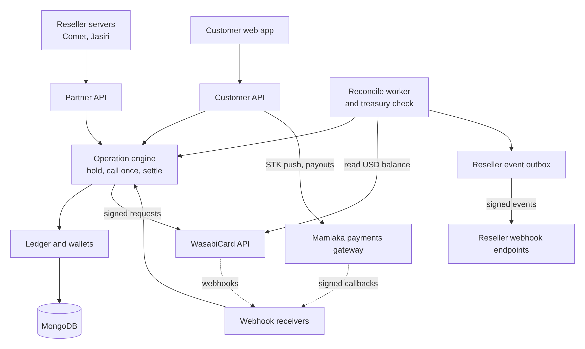

*Diagram: System architecture. Click the image to enlarge. Editable source: [01-architecture.mmd](docs/diagrams/01-architecture.mmd).*

| Component | Responsibility | Code |
|---|---|---|
| Operation engine | Records intent, holds funds, calls Wasabi once, settles | `app/cards/service.py`, `app/transactions/orchestrator.py` |
| Ledger | Idempotent credit, reserve, capture, release on integer minor units | `app/wallet/ledger.py` |
| Partner layer | Reseller accounts, API keys, customers, floats, events | `app/partners/` |
| Gateway client | STK collections and payouts, signed callbacks | `app/mobilemoney/` |
| Treasury | Real Wasabi USD against reseller floats | `app/core/treasury.py` |
| Reconcile worker | Recovers anything a webhook missed | `app/jobs/reconcile.py` |

## 4. Customer journey

The customer-facing application tracks one ordered journey of seven steps, exposed at `GET /api/v1/journey` and streamed over Server-Sent Events.

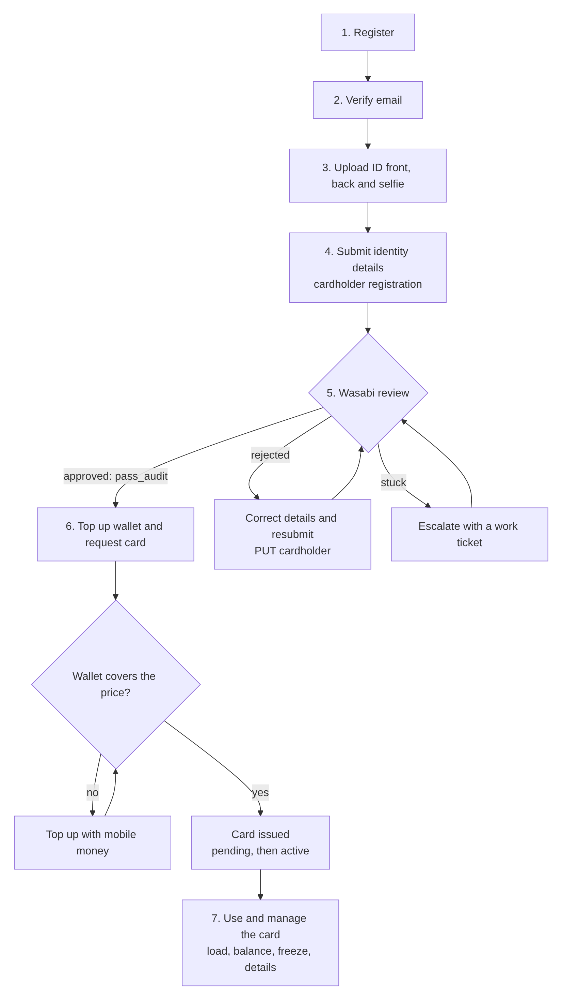

*Diagram: Customer journey. Click the image to enlarge. Editable source: [02-customer-journey.mmd](docs/diagrams/02-customer-journey.mmd).*

Wasabi's cardholder statuses are `wait_audit`, `under_review`, `pass_audit` (approved) and `reject`. Approval is Wasabi's decision: Mamlaka can only observe it, escalate, or help the customer resubmit. KYC is **once per person**: an approved cardholder can hold several cards.

Rules that cause most rejections: names, ID number and the **date of issue must match the ID exactly**; first plus last name at most 32 characters; address and town accept letters, numbers, hyphens and spaces only; the contact email must be unique across the whole merchant account.

## 5. Operations: the idempotent lifecycle

Every action that touches Wasabi (create holder, create card, deposit, withdraw, freeze, cancel) follows one lifecycle.

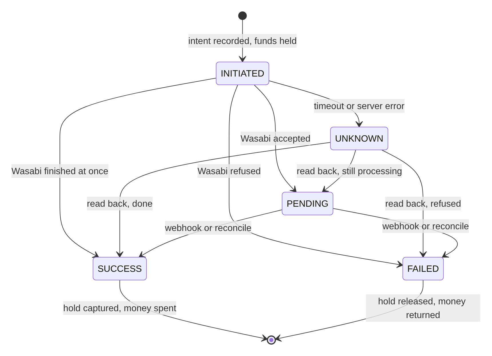

*Diagram: Operation lifecycle states. Click the image to enlarge. Editable source: [03-operation-lifecycle.mmd](docs/diagrams/03-operation-lifecycle.mmd).*

How funds behave in each state:

| State | Wallet or float |
|---|---|
| `INITIATED`, `PENDING`, `UNKNOWN` | **Held** (moved from `available` to `held`). Nothing is lost or released. |
| `SUCCESS` | Held amount **captured** (spent). |
| `FAILED` | Held amount **released** (returned). |

Guarantees:

- **Idempotent.** The Wasabi order number is derived from the user, the operation and a client `Idempotency-Key`. A repeated request returns the stored state and never charges or sends twice.
- **Exactly once.** Every ledger change has a unique `entry_key` (`<reference>:<kind>`). A hold is captured **or** released, never both, however many times a callback replays.
- **Unknown is not failed.** A timeout, a 5xx or an unparsable reply means the provider may have processed it. The operation stays held until a webhook or the reconcile worker reads the real state.
- **Final states never move backwards.** A late `PENDING` cannot overwrite a recorded `SUCCESS`.

### 5.1 Issuing a card (customer paying from the wallet)

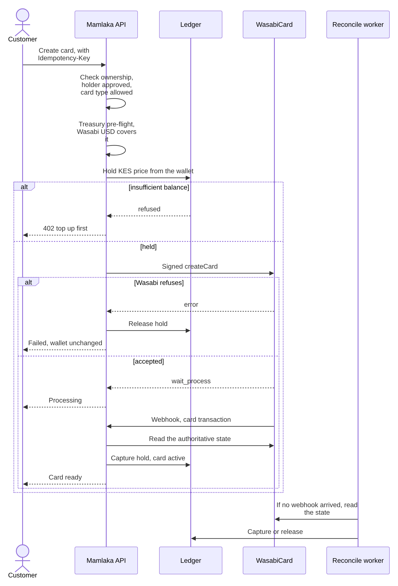

*Diagram: Issuing a card from the wallet. Click the image to enlarge. Editable source: [04-card-issuance-sequence.mmd](docs/diagrams/04-card-issuance-sequence.mmd).*

## 6. Money, ledgers and settlement

### 6.1 Three separate balances

The most important thing to understand is that **three different pools of money exist**, owned by different parties.

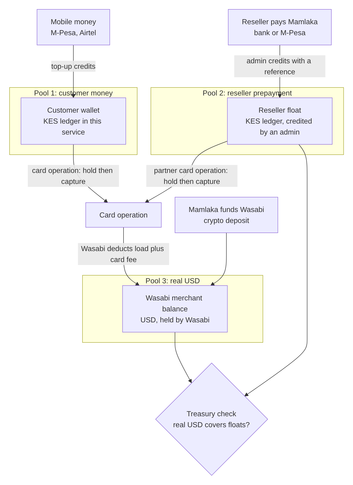

*Diagram: The three balances. Click the image to enlarge. Editable source: [05-three-balances.mmd](docs/diagrams/05-three-balances.mmd).*

- A **customer wallet** holds KES the customer has paid in. It is a ledger number backed by money in the payments gateway account.
- A **reseller float** is a ledger number that says "this reseller has prepaid Mamlaka this much". It is **not cash**: it is only a promise unless real USD backs it.
- The **Wasabi merchant balance** is the only place real USD is deducted when a card is created. Mamlaka funds it directly with Wasabi.

### 6.2 Settlement cycle with a reseller

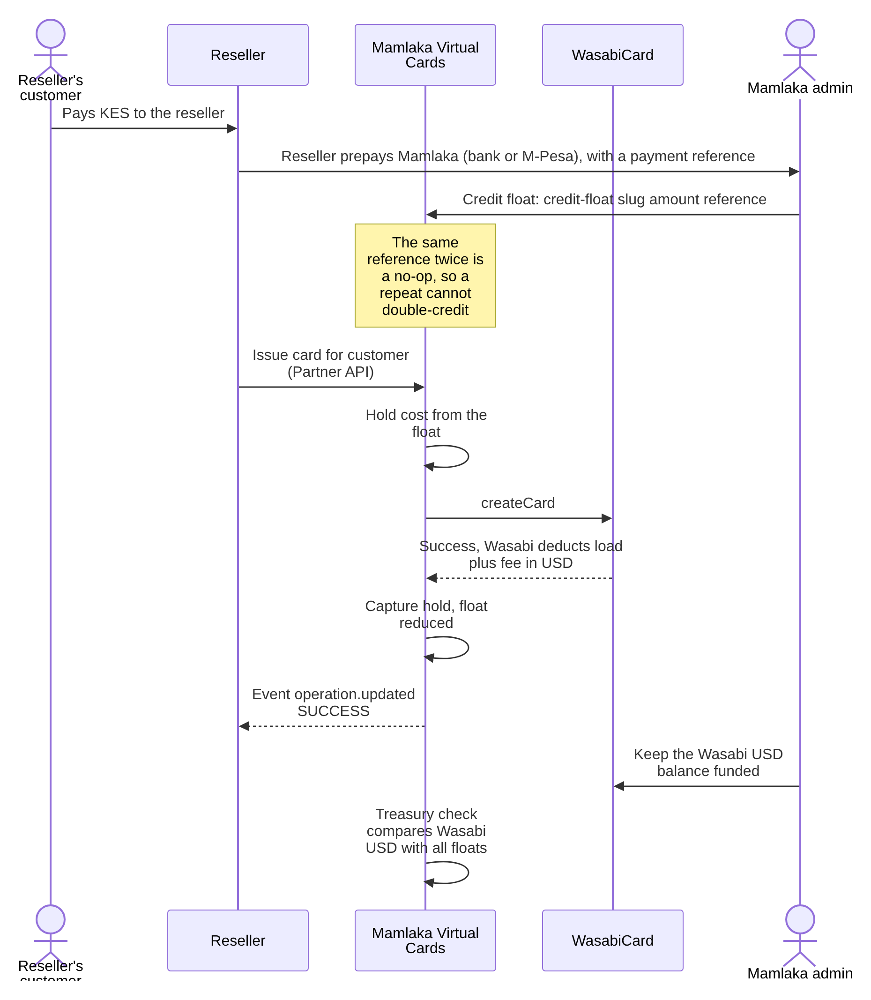

*Diagram: Settlement cycle with a reseller. Click the image to enlarge. Editable source: [06-settlement-cycle.mmd](docs/diagrams/06-settlement-cycle.mmd).*

### 6.3 Pricing

A card operation has a **cost**, set by Mamlaka from the live Wasabi catalog: the opening load plus the card fee, converted from USD to KES at the configured rate (`FX_KES_PER_USD`). A reseller prices its own customer from that cost.

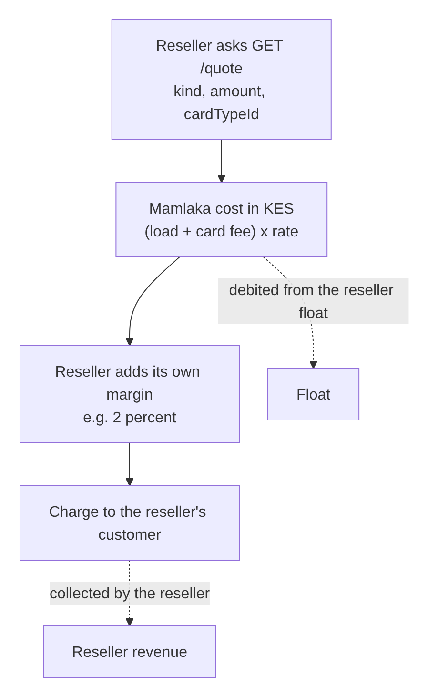

*Diagram: Pricing: cost, margin and charge. Click the image to enlarge. Editable source: [07-pricing.mmd](docs/diagrams/07-pricing.mmd).*

Worked example (rate 129.50, a $10 card with a $2 card fee): cost = (10 + 2) x 129.50 = **KES 1,554.00** from the float. With a 2 percent margin the reseller charges its customer **KES 1,585.08** and keeps KES 31.08. Quoting from Mamlaka's own cost means a rate change on Mamlaka's side can never leave the reseller out of pocket.

### 6.4 Treasury: keeping the pools honest

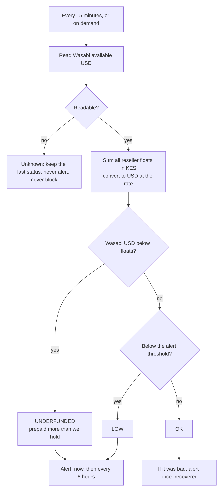

*Diagram: Treasury check. Click the image to enlarge. Editable source: [08-treasury-check.mmd](docs/diagrams/08-treasury-check.mmd).*

The same check runs as a **pre-flight** on every issuance and card deposit: if the real Wasabi balance cannot cover the request (plus a configured reserve), it is refused cleanly before anything is held, and the caller is told only that the service is temporarily unavailable. If Wasabi cannot be asked, requests are not blocked: Wasabi's own refusal is still handled and refunded.

## 7. Top-ups and withdrawals

Customers fund the KES wallet through the Mamlaka payments gateway (M-Pesa and Airtel) or, optionally, direct Safaricom Daraja. The wallet is credited only after the provider confirms payment **and** the confirmed amount equals the amount requested.

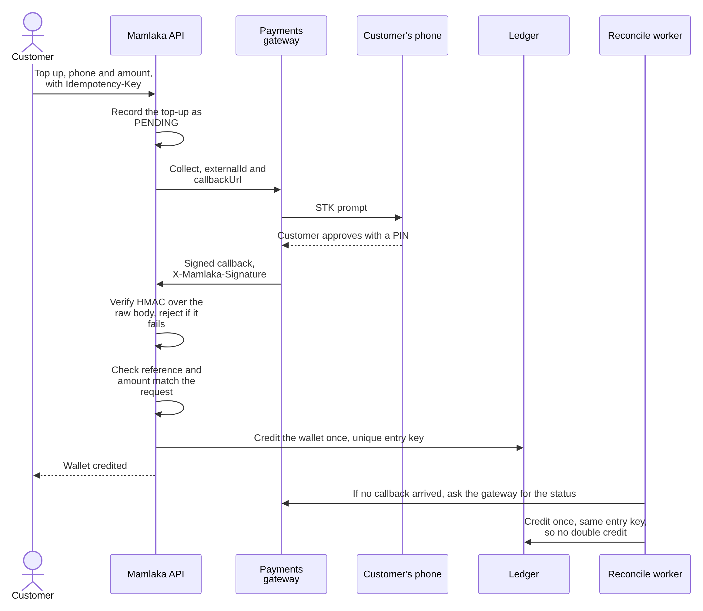

*Diagram: Top-up through the payments gateway. Click the image to enlarge. Editable source: [09-top-up-sequence.mmd](docs/diagrams/09-top-up-sequence.mmd).*

Withdrawals to a phone follow the same lifecycle as card operations: the KES is **held first**, the gateway is called once, a confirmed payout captures the hold, a failure releases it, and an unknown outcome keeps it held. Withdrawals can only go to the phone number registered on the account and are off by default (`WALLET_WITHDRAW_ENABLED`), because they move real money out.

## 8. The reseller (partner) model

A reseller is a **tenant**. Its customers are stored as `<tenant_id>:<externalId>`, so every wallet, cardholder, card and operation is isolated per reseller by the same ownership checks the first-party app uses. A reseller can never read or act on another reseller's customers: the answer is simply "not found".

### 8.1 Onboarding a reseller

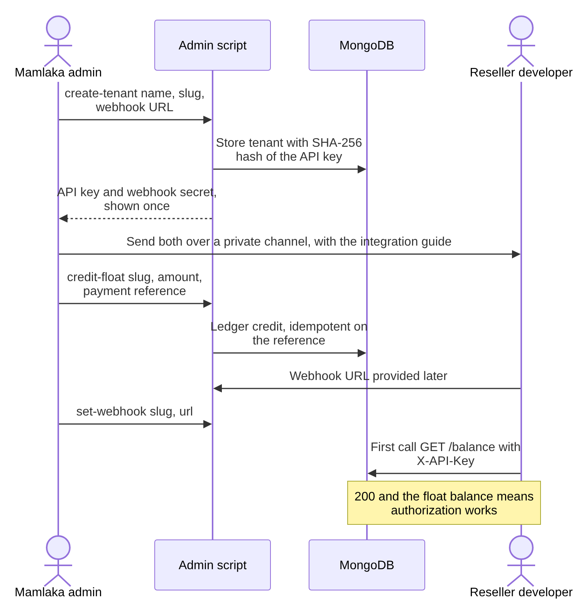

*Diagram: Onboarding a reseller. Click the image to enlarge. Editable source: [10-partner-onboarding.mmd](docs/diagrams/10-partner-onboarding.mmd).*

The API key is a 256-bit random value, shown once and stored only as a hash. A lost or leaked key is replaced with `rotate-key`; the old key stops working immediately.

### 8.2 A reseller's customer, end to end

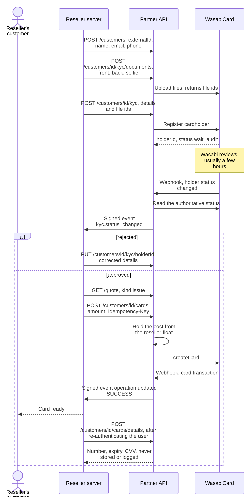

*Diagram: A reseller's customer, end to end. Click the image to enlarge. Editable source: [11-partner-customer-journey.mmd](docs/diagrams/11-partner-customer-journey.mmd).*

### 8.3 Events sent to a reseller

Events are stored first, then delivered, so a reseller that is briefly down still receives everything. Delivery is **at least once**: a reseller must ignore repeats using the event `id`.

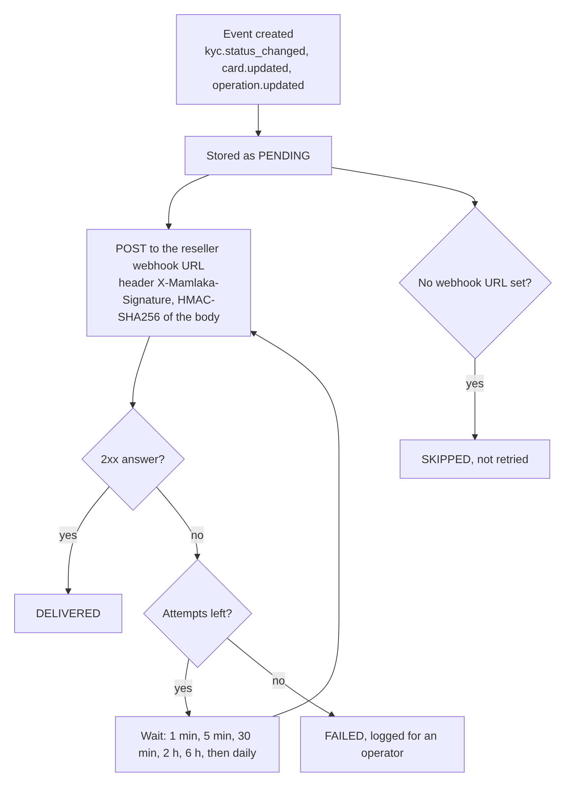

*Diagram: Delivery of events to a reseller. Click the image to enlarge. Editable source: [12-reseller-events.mmd](docs/diagrams/12-reseller-events.mmd).*

### 8.4 A worked example: Jasiri

Jasiri is a retail app that adds virtual cards as a funding channel under **Deposits**. It is a reseller that also keeps its own customer wallets.

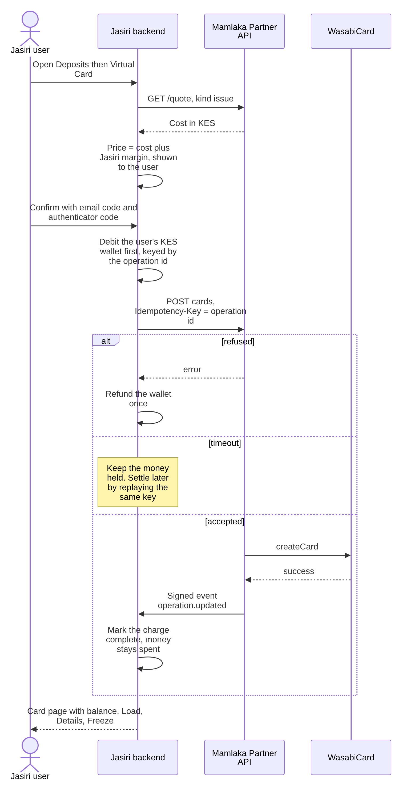

*Diagram: Worked example: Jasiri. Click the image to enlarge. Editable source: [13-jasiri-example.mmd](docs/diagrams/13-jasiri-example.mmd).*

Jasiri's wallet debit is its own money rule: Jasiri charges the user first, calls Mamlaka with the operation id as the idempotency key, and refunds exactly once on a definitive refusal.

## 9. Reliability: reconciliation and the webhook trust model

**Webhooks are hints, not truth.** A callback only says *which* holder, card or operation changed. Every handler re-reads the authoritative state from Wasabi's API, so a forged callback can at worst cause an extra read. Callbacks are deduplicated on Wasabi's `X-WSB-REQUEST-ID`; gateway callbacks and reseller events are authenticated with an HMAC over the raw body.

The reconcile worker covers everything a webhook missed. Wasabi stops retrying a webhook after about 37 hours, so the worker must always run.

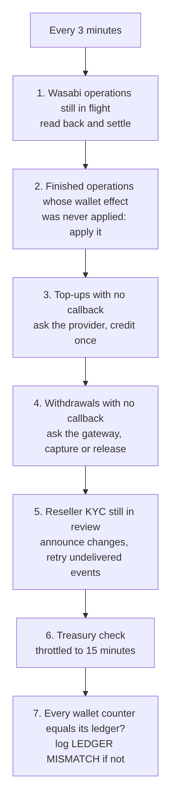

*Diagram: Reconcile worker passes. Click the image to enlarge. Editable source: [14-reconcile-passes.mmd](docs/diagrams/14-reconcile-passes.mmd).*

## 10. Security model

| Area | Control |
|---|---|
| Customer authentication | JWT (HS256); bcrypt (cost 12) passwords with a strength policy; lockout after 5 failed logins; per-endpoint rate limits; no account enumeration |
| Ownership | Every card, holder, wallet, top-up and operation is filtered by the token's user, or by the reseller's tenant |
| Reseller authentication | `X-API-Key`, stored only as a SHA-256 hash, shown once, rotatable; 600 requests per minute per reseller |
| Requests to Wasabi | RSA SHA-256 signature over the exact serialized bytes sent |
| Inbound webhooks | Wasabi: re-read state, deduplicate. Gateway and reseller events: HMAC-SHA256 over the raw body, constant-time compare |
| Card data | Full number and CVV are never stored or logged. The reseller reveal endpoint audits who revealed which card (never the values) and is `Cache-Control: no-store` |
| Secrets | `.env` and `app/keys/*.pem` are git-ignored and mounted at runtime, never baked into the image |
| Production switches | The test token, dev email preview and auto-verify are forced off when `APP_ENV=production` |
| Documents | KYC images are validated for type (JPG, PNG, PDF), magic bytes and 2 MB size, and sent to Wasabi. Identity values are not kept in general-purpose records |

## 11. Status: what is done, and what must still close

### 11.1 Resolved since version 1.0

| v1.0 finding | Now |
|---|---|
| Wrong field names (`cardId`), missing `merchantOrderNo` | Contract aligned: `cardNo`, `merchantOrderNo` on every mutation |
| Float and integer amount handling | Decimal-safe amounts; integer minor units in the ledger |
| No ownership or real users | Real accounts, ownership enforced on every route, uploads authenticated; test token off in production |
| Callbacks not verified or reconciled | Deduplicated, treated as hints, plus a reconcile worker |
| Secrets in the image, payload logging | `.dockerignore` fixed, secrets injected at runtime, bodies not logged |
| No idempotency or reconciliation | Intent recorded first, deterministic references, unknown outcomes held |
| Holder and card data not persisted | Holders, cards and operations persisted and linked to owners |
| No wallet or ledger | Wallet ledger with holds, M-Pesa and gateway top-ups, withdrawals |
| No UI | A user app exists in a separate repository |
| No reseller support | Partner API, tenants, floats, signed events, admin script |

### 11.2 Open before real customers

These are known and not yet fixed:

1. **Ledger atomicity.** A wallet counter and its ledger entry are written in two steps. A crash between them can leave a hold with no ledger entry. The reconcile worker detects a mismatch but does not repair it. Use MongoDB transactions.
2. **Customer money routes do not re-check the account.** They authenticate the token only, so a suspended or unverified user keeps access until the token expires.
3. **Card details on the customer route.** `POST /cards/sensitive` needs a step-up (email code plus authenticator), as the reseller side already does.
4. **STK push to any number.** A top-up can be started for a phone that does not belong to the account, and money endpoints are not rate-limited.
5. **Automatic failure of unseen operations.** After 30 minutes without a record at Wasabi, an operation is marked failed and its hold released. If Wasabi's listing lags, a card could be paid for twice. Such cases should go to manual review.
6. **Wasabi response signatures are not verified**, and the webhook signature algorithm is unconfirmed. Today state is re-read through Wasabi's API instead.
7. **No password reset**, and the email sender's payload matches no real provider.
8. **No FX feed.** The KES to USD rate is set by hand and can go stale.
9. **No sandbox for resellers.** Partners integrate against live Wasabi unless a simulated processor is built.
10. **Card-data scope.** Revealing full card details puts the revealing system in PCI DSS scope. Prefer a hosted reveal.
11. **Settlement is manual.** A reseller's payment and its float credit are matched by an administrator; per-reseller fees and automatic settlement are not built.
12. **Compliance.** Holding customer balances, the data-protection duties around KYC, and the agreement with the card provider are contractual and licensing matters, not code.
13. **Observability.** There are logs and treasury alerts but no metrics dashboard.

## 12. Live rollout boundary

Production activation is an operational change, not an environment-variable swap. Before release, confirm with Wasabi:

- The live API host, merchant account, card-type access and enabled operations.
- The production API key and the merchant public key that matches the mounted private key.
- Production egress IP allowlisting and the public HTTPS webhook URL.
- The webhook signing algorithm, and the enabled callback categories.

Keep sandbox and production credentials, keys, databases and callback URLs separate. Fund the Wasabi merchant balance before the first card, and use the smallest permitted amounts for live smoke tests. Never run a test with real funds just to discover a payload or status.

## 13. Testing

The automated suite (`python -m pytest -q`) covers signing and canonicalisation, ownership isolation, idempotent operations, hold, capture and release, unknown outcomes, callback deduplication and signatures, the gateway and M-Pesa top-ups, withdrawals, the Partner API (including isolation between resellers and signed event delivery), the treasury pre-flight and alerts. It uses in-memory fakes and never reaches Wasabi, MongoDB or M-Pesa.

Live verification is manual and staged: read-only calls first, then one minimal mutation at a time, reconciled against Wasabi's portal and the local records.

## 14. References

- [README](README.md), [API](docs/API.md), [Deployment](docs/DEPLOY.md), [Operations](docs/OPERATIONS.md)
- [Reseller integration guide](docs/PARTNER_INTEGRATION_GUIDE.md) and [Partner API reference](docs/PARTNER_API.md)
- [WasabiCard Quick start](https://wsb.gitbook.io/wasabicard-doc/guides/quickstart.md)
- [WasabiCard Card API](https://wsb.gitbook.io/wasabicard-doc/api/card/cards.md)
- [WasabiCard Cardholder API](https://wsb.gitbook.io/wasabicard-doc/api/card/card-holder.md)
- [WasabiCard Account API](https://wsb.gitbook.io/wasabicard-doc/api/account.md)
- [WasabiCard Webhooks](https://wsb.gitbook.io/wasabicard-doc/api/webhooks.md)
