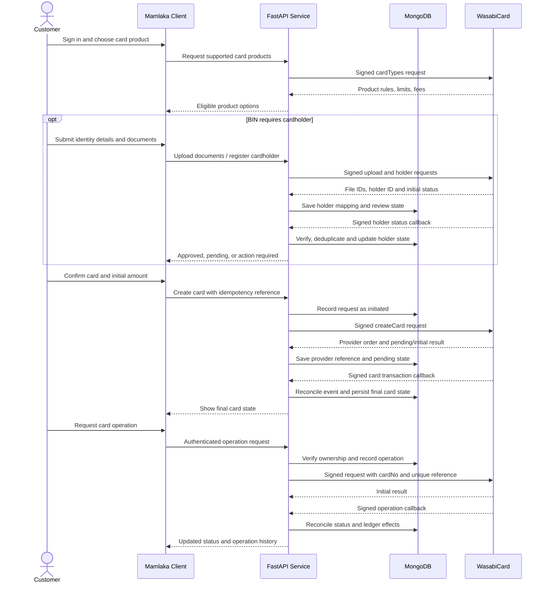

# Mamlaka Virtual Cards Integration

## Customer Journey and Technical Whitepaper

**Version:** 1.0
**Date:** 2026-10-05
**Provider:** WasabiCard
**Status:** Architecture and implementation review; not a statement of production readiness

---

## 1. Executive Summary

Mamlaka's virtual-card service is a backend integration between an authenticated Mamlaka application and WasabiCard. It is intended to let an eligible customer select a supported card product, complete identity verification, request a virtual card, and manage that card through controlled operations such as balance inquiry, funding, freezing, and cancellation.

The application is a FastAPI service. It validates incoming requests, calls WasabiCard's merchant APIs, signs outbound request bodies with the merchant RSA private key, and uses MongoDB for application and transaction records. WasabiCard remains the external card-program provider: it determines supported products, performs provider-side cardholder review and card issuance, and reports asynchronous operation outcomes.

The repository contains much of this integration skeleton, but it is **not yet a complete production customer-card system**. In particular, request fields do not consistently match Wasabi's contract, card and holder ownership/status are not persisted and enforced, callbacks are not verified or reconciled, monetary precision is lost in the client, and wallet/ledger accounting is not connected to card funding. The flows below describe the intended safe customer experience and identify which parts exist today versus which still require implementation.

## 2. Scope and Participants

The system has four parties:

- **Customer:** Uses Mamlaka's client application to request and manage a card.
- **Mamlaka application:** Authenticates the customer, enforces ownership and business rules, records local state, and exposes customer-facing APIs.
- **WasabiCard:** Provides card products and merchant APIs, performs cardholder/card processing, and sends callback events.
- **Operations and compliance teams:** Configure production credentials, IP allowlisting, callback destinations, product eligibility, incident handling, and reconciliation.

This repository provides backend endpoints. It does not contain a customer web or mobile interface, a complete wallet accounting implementation, or an operational support console. Product copy and screens described in this paper are requirements for a customer-facing client, not existing UI features.

## 3. Intended Customer Journey

### 3.1 Discover an eligible card

The customer signs in and views card products that Mamlaka has enabled. The client gets available products through the supported-BINs API and displays only options that meet the customer's country, currency, cardholder, funding, and account eligibility rules. Product fees, initial funding requirements, limits, supported usage, and important restrictions should be shown before the customer confirms.

The Wasabi response contains product-specific properties such as `cardTypeId`, `organization`, `country`, `mode`, `needCardHolder`, deposit requirements, fees, and supported regions. Product eligibility must be derived from this live configuration rather than a BIN ID or KYC assumption hard-coded into the application.

### 3.2 Complete identity verification when required

If the selected BIN requires a cardholder, the customer supplies the provider-required identity and billing information. The client uploads the permitted document images or PDF and receives provider file identifiers. Mamlaka submits the cardholder request and records the returned `holderId` and review state.

The customer sees a clear state such as **In review**, **Action required**, **Approved**, or **Declined**. Card creation is available only after Wasabi reports an approved holder, such as `pass_audit`. A pending review is not a successful approval. Rejected applications should show a safe, useful explanation and a correction path where the provider permits resubmission.

KYC data is highly sensitive. The customer should see the purpose of collection, who processes it, retention/support arrangements, and any applicable privacy notice before submitting it. The application must not expose another customer's KYC record or persist identity values in general-purpose logs.

### 3.3 Confirm and request card creation

After eligibility and any required holder approval, the customer confirms the card type and initial amount. The client should explain any issuance fee, initial deposit, currency, limits, and the fact that the provider may process the request asynchronously.

Mamlaka creates a stable idempotency/reference value, records the request, and calls Wasabi's V2 create-card endpoint. A response such as `wait_process` or `processing` is shown as **Processing**, not **Ready**. The customer receives a card only after the final provider state confirms successful issuance and Mamlaka has safely associated the returned provider `cardNo` with the authenticated customer.

### 3.4 Use and manage the card

After issuance, the customer can view non-sensitive status and balance information, request sensitive card details through a strongly authorized flow, and perform supported operations such as deposit, withdraw, freeze, unfreeze, or cancel. Each action should display the amount, fees, effect, and confirmation step before submission.

Every operation must be authorized against the local owner-to-card mapping. Sensitive card data should be disclosed only to the owner after step-up controls appropriate to the product; it must not be written to normal logs or retained unnecessarily. Card purchase and merchant authorization activity is performed on the card network. The current repository does not implement customer purchase-history views.

### 3.5 Track outcomes and get support

The customer sees a durable operation history with a reference, amount/currency when applicable, timestamp, and current status. Pending states remain pending until a verified Wasabi callback or provider query supplies a final result. A timeout is an **unknown outcome**, not proof that an operation failed; the client must not blindly submit another charge/funding request.

Support staff need the Mamlaka reference and Wasabi provider references to investigate. The customer-facing interface must not expose cryptographic material, full identity documents, private keys, or unmasked card details in support logs.

## 4. End-to-End System Flow

### 4.1 Target request path

1. **Authenticate and authorize:** Validate the customer's identity and resolve their stable internal user ID. Check that the requested card or holder belongs to them.
2. **Validate:** Apply Wasabi field names, data types, limits, BIN configuration, operation-specific required fields, and currency rules.
3. **Record intent:** Create an idempotent local transaction before calling Wasabi. Do not record card creation, deposits, or withdrawals as completed merely because the API returned an HTTP response.
4. **Sign and send:** Normalize the body once, serialize the exact bytes, sign those exact bytes using RSA/SHA-256 and the merchant private key, and send the body with `X-WSB-API-KEY` and `X-WSB-SIGNATURE`.
5. **Verify response:** Validate the provider response signature using Wasabi's platform public key before trusting the response body.
6. **Reconcile:** Process signed callback events idempotently, update transaction and cardholder/card state, and respond with Wasabi's documented success acknowledgement. Query provider transaction/card status to recover from missed callbacks.
7. **Notify customer:** Expose the reconciled application state, not an unverified or incomplete provider response.

The repository currently implements outbound body signing and calls the listed card APIs, but steps 1, 3, 5, and 6 are incomplete or partial as described in Section 8.

## 5. Current API Surface

All paths below are mounted beneath `/api/v1/cards`, except the webhook path. The route definitions are in `app/cards/routeendpoint.py` and application mounting is in `app/main.py`.

| Route | Purpose | Current implementation notes |
|---|---|---|
| `POST /supported-BINS/types` | Read available Wasabi card products | Authenticated. Product eligibility should be filtered and explained by Mamlaka. |
| `GET /list-BINS?page=1&pageSize=10` | List cards | Authenticated. Current request adds `userId`, which is not in the documented Wasabi card-list filters; local ownership filtering is required. |
| `GET /diagnostic/kenya-cities` | Look up Kenya city codes | Authenticated diagnostic endpoint; not a general customer workflow. |
| `POST /kyc/upload` | Upload a KYC file | Currently has no authentication dependency or explicit size/type enforcement in the route. Wasabi documents JPG/PNG/PDF and a 2 MB maximum. |
| `POST /cardholder/register` | Register a cardholder | Authenticated, but the route does not persist holder status or associate the result with a local user. |
| `POST /kyc/submit` | Submit a Wasabi work ticket | Authenticated and currently routed through the transaction-aware service. This is a work ticket, not a replacement for provider cardholder creation/approval. |
| `POST /create` | Create a virtual card | Authenticated and transaction-logged, but holder approval/ownership and card persistence are not enforced. |
| `POST /info` | Get card information | Current schema uses `cardId`; Wasabi documents `cardNo`. |
| `POST /sensitive` | Request encrypted sensitive card details | Current schema uses `cardId`; strong owner authorization and provider-data decryption are not implemented. |
| `POST /balance` | Get card balance | Current schema uses `cardId`; Wasabi documents `cardNo`. |
| `POST /deposit` | Fund a card | Current schema uses `cardId`; amount is converted to an integer by the client. Local wallet/ledger accounting is not connected. |
| `POST /withdraw` | Withdraw from a card | Current schema uses `cardId`; amount is converted to an integer by the client. Local wallet/ledger accounting is not connected. |
| `POST /freeze`, `POST /unfreeze` | Freeze or unfreeze a card | Current schema uses `cardId`; required `merchantOrderNo` is not added by these routes. |
| `POST /cancel` | Cancel a card | Current schema uses `cardId`; the request reference is generated, but ownership and local state changes are not implemented. |
| `POST /api/v1/webhooks/wasabi` | Receive Wasabi callbacks | Mounted under `/api/v1/webhooks`, not `/api/v1/cards`. Current handler stores raw JSON but does not verify or reconcile it. |

The current README lists `/api/v1/cards/work-order/submit` and `/api/v1/cards/wasabi`; those do not match the routes mounted by the code. The implemented paths are `/api/v1/cards/kyc/submit` and `/api/v1/webhooks/wasabi`.

## 6. Provider and Cryptographic Integration

### 6.1 Environments and credentials

`WASABI_BASE_URL` and `WASABI_API_KEY` are read in `app/core/config.py`. The base URL must be the exact production merchant API endpoint provided by Wasabi for the live account. The published quickstart names the sandbox endpoint and notes that production requires merchant IP allowlisting; do not derive or guess a live URL.

The deployment must pair the production API key with the correct merchant RSA private key and corresponding merchant public key registered in Wasabi. The merchant private key signs outbound API requests. Wasabi's platform public key verifies signed responses and callbacks. These are different trust roles and must not be interchanged. The repository has key paths/configuration, but platform response/callback verification is not wired into the flow.

### 6.2 Outbound requests

`app/cards/wasabi_client.py` removes `None` values, creates sorted compact JSON, and sends it as the request body. `app/core/signature.py` signs compact sorted JSON using RSA PKCS#1 v1.5 with SHA-256 and Base64 encodes the signature. This aligns with the Wasabi quickstart's broad signing method; the critical production test is that the exact bytes signed are the exact bytes transmitted for every payload type.

The client currently casts `amount` to `int`, prints payloads/signatures/responses, and does not verify response signatures or robustly translate HTTP/non-JSON errors. Do not treat a network timeout or parse error as a definite provider-side failure: the provider may have processed the request. Use stable idempotency references and reconciliation before retrying.

### 6.3 Live rollout boundary

Production activation is an operational change, not just an environment-variable swap. Before release, verify with Wasabi:

- The live API hostname, merchant account, product/BIN access, and enabled operations.
- Production API key and registered merchant public key corresponding to the mounted private key.
- Wasabi platform verification public key for signed responses and notifications.
- Production egress IP allowlisting and the publicly reachable HTTPS callback URL.
- Callback categories enabled and any provider-side test procedure/limits.

Keep sandbox and production credentials, keys, callback URLs, databases, and deployments separated. Live smoke tests should use provider-approved accounts and the smallest permitted amounts.

## 7. Persistence and Financial Records

`app/core/database.py` defines these MongoDB collections:

| Collection | Intended responsibility | Current use in this repository |
|---|---|---|
| `users` | Customer identity references and account state | Defined; not used by the card flow shown. |
| `wallets` | Mamlaka customer balances or funding accounts | Defined; not integrated into card deposit/withdraw routes. |
| `cards` | Provider card ID, owning user, BIN, status and safe display metadata | Defined; not written by card issuance flow shown. |
| `transactions` | Mamlaka operation reference, request type, status, provider response/reference, timestamps | Used by create-card and KYC-work-order service; webhooks are currently inserted here as raw events. |
| `ledger` | Immutable financial debits, credits, fees and reconciliation entries | Defined; not integrated into the current Wasabi card operations. |

Before live customer funds are enabled, define transaction and ledger semantics with finance/product. A Wasabi deposit request is not automatically a Mamlaka wallet debit: this repository does not currently debit a customer wallet, reserve funds, write balanced ledger entries, or reconcile Wasabi's merchant account. Decide and implement the funding source and accounting contract before describing deposits as wallet-backed.

Recommended data protections and indexes:

- Unique index on the Mamlaka idempotency key / `merchant_order_no` for each transaction namespace.
- Unique index on Wasabi callback `X-WSB-REQUEST-ID` or a documented stable event identity for deduplication.
- Indexes for card lookup by provider `cardNo` and owner ID, holder lookup by provider `holderId` and owner ID, and transaction lookup by provider `orderNo` and Mamlaka reference.
- Store the minimum KYC data needed to operate and support the product. Avoid copying full ID numbers, raw documents, PAN, CVV, or private key material into generic transaction records and logs.
- Define access control, encryption at rest/in transit, retention/deletion, audit access, backups, and incident procedures for sensitive records.

## 8. Production Readiness Findings

These findings are implementation gaps, not customer-facing promises.

### P0: Resolve before live card mutations

1. **Match Wasabi's API contract.** Use `cardNo`, not `cardId`, for documented card endpoints. Add `merchantOrderNo` to freeze/unfreeze and confirm every payload against the current provider spec. Do not send undocumented `userId` to card listing as a security control.
2. **Preserve money precision.** Replace float/int amount handling with decimal-safe validation and serialization; test fractional values and currency scale.
3. **Authenticate, authorize, and enforce ownership.** Associate JWT subject with a real user record; verify every requested holder/card belongs to that user. Protect `/kyc/upload`. Remove or disable the unauthenticated `/token` test endpoint in production.
4. **Verify Wasabi responses and callbacks.** Validate `X-WSB-SIGNATURE` against the raw response/callback bytes with Wasabi's public key. Reject invalid signatures. Persist callback request IDs and process events idempotently. Return Wasabi's documented callback acknowledgement.
5. **Do not expose secrets in container images/logs.** Rename/fix the Docker ignore file to `.dockerignore`, explicitly exclude `.env`, keys, `.git`, virtual environments, and local artifacts, and inject secrets at runtime. Remove full payload/signature logging.
6. **Make operations idempotent and reconcilable.** Persist intent before provider calls; use stable client idempotency references; treat unknown timeouts as pending; query provider status and reconcile callbacks before retrying.

### P1: Complete before onboarding customers

- Persist cardholder/card data and provider states; block create until any required cardholder is approved.
- Validate uploaded file type/size (Wasabi documents JPG, PNG, PDF up to 2 MB); bind uploads and holder submissions to the authenticated customer.
- Implement encrypted sensitive response decryption using the merchant private key, and a narrowly authorized delivery path. Never persist/log CVV.
- Add response/error handling for HTTP status, malformed provider JSON, connection timeout, and provider business error codes. Do not translate every error to a definitive failed transaction.
- Implement local wallet and ledger behavior only after its funding, reservation, refund, fee, and reconciliation rules are approved.
- Align public documentation with actual API paths and use a real production identity/authentication provider rather than the test token flow.

### P2: Operational hardening

- Add metrics and alerts for callback verification failures, callback delays, pending transactions, provider errors, duplicate references, and reconciliation differences.
- Add a scheduled reconciliation process for callbacks missed during outages, with an operator-visible exception queue.
- Add rate limits, request-size limits, TLS enforcement, secret rotation procedures, backup/restore tests, and production incident runbooks.
- Add provider-approved integration tests that cannot accidentally target live funds by default.

## 9. Recommended Test Plan

1. **Unit tests:** Canonical JSON/signature byte equivalence; response/callback signature verification; required fields and bounds; decimal amounts; generated order reference length; file type/size; status mapping; callback deduplication.
2. **Contract tests:** Compare each client endpoint and request body with the current Wasabi docs, including `cardNo`, `merchantOrderNo`, paging maximums, response envelopes, and operation-specific fields.
3. **Database tests:** Unique idempotency constraints, owner isolation, holder/card persistence, transaction transitions, duplicate/out-of-order callbacks, and recovery after a simulated timeout.
4. **Sandbox end-to-end:** Product lookup, conditional holder registration and approval, card creation, pending-to-final callback, info/balance, supported card operations, and reconciliation. Confirm failure behavior as well as success.
5. **Production smoke test:** Only after Wasabi confirms live credentials, IP allowlisting, callback setup, and an approved test profile. Run read-only calls first, then one explicitly authorized minimal-value mutation at a time; reconcile against both Wasabi's portal and local records before expanding.

Never run a test with real production funds merely to discover the expected payload or status behavior.

## 10. Customer-Facing Service Commitments

A customer-facing Mamlaka product should communicate that:

- Card availability depends on the selected product, region, provider rules, and identity review.
- A submitted application or card operation can remain pending while Wasabi processes it.
- Fees, limits, currencies, supported uses, and restrictions vary by card product and should be shown before confirmation.
- Card controls and balances can take time to reflect provider-side processing; the operation history is the source for current request status.
- Sensitive card information is protected and shown only to the authorized cardholder.
- A support request should use an operation reference, not identity documents, private keys, or card security codes in ordinary messages.

These are product requirements. They are not all implemented in the current repository.

## 11. Current State in One View

| Capability | Repository status |
|---|---|
| FastAPI app and card route mounting | Present |
| Wasabi outbound RSA request signing | Present; must verify byte-level contract and remove sensitive logs |
| Supported BINs, cardholder, card, funding, and control client calls | Mostly present; several route schemas/payloads mismatch documented fields |
| Transaction record for card creation and work-order submission | Partial; not consistently applied to all provider mutations |
| Holder/card records and user ownership checks | Not implemented in the reviewed flow |
| Response and webhook signature verification | Not implemented |
| Callback event deduplication and transaction/card reconciliation | Not implemented |
| Exact decimal-safe financial handling | Not implemented; current amount cast truncates decimals |
| Local wallet/ledger funding and reconciliation | Collections exist; card routes do not integrate them |
| Production secret/image isolation | Git ignores secrets, but Docker ignore filename/content must be fixed |
| Customer-facing UI and support workflows | Not present in this repository |

## 12. Documentation References

- [WasabiCard Quick start](https://wsb.gitbook.io/wasabicard-doc/guides/quickstart.md)
- [WasabiCard Card API](https://wsb.gitbook.io/wasabicard-doc/api/card/cards.md)
- [WasabiCard Cardholder API](https://wsb.gitbook.io/wasabicard-doc/api/card/card-holder.md)
- [WasabiCard Common APIs, upload, and tickets](https://wsb.gitbook.io/wasabicard-doc/api/common.md)
- [WasabiCard Card issuance process](https://wsb.gitbook.io/wasabicard-doc/guides/card-issuance-process.md)
- [WasabiCard Card status flow](https://wsb.gitbook.io/wasabicard-doc/guides/card-status-flow.md)
- [WasabiCard Webhooks](https://wsb.gitbook.io/wasabicard-doc/api/webhooks.md)
